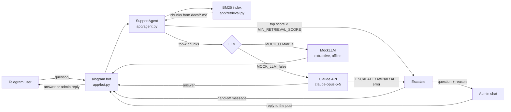

# ai-support-bot

[](https://github.com/jjebraham/ai-support-bot/actions/workflows/ci.yml)

A Telegram support bot that answers customer questions from a small set of help articles, using BM25 retrieval and the Claude API. When it is not sure, it hands the question to a human admin chat instead of guessing.

The help articles in [`docs/`](docs) describe **Parcelo**, a made-up parcel delivery company. All data in this repo is fictional.

## The problem

Small support teams get the same questions every day: "where is my parcel", "how long does a refund take", "how do I reset my password". A bot can answer these at any hour, but a bot that makes up a refund policy is worse than no bot. This one is built around two rules:

1. **Answer only from the docs.** The model sees just the retrieved articles and is told not to invent prices, dates or policies.
2. **Escalate when unsure.** If retrieval finds nothing relevant, if the model says the articles don't cover the question, or if the API fails, the user gets a polite hand-off message. The question goes to `ADMIN_CHAT_ID`, and the admin's reply is relayed back to the user.

## Architecture



| File | What it does |
| --- | --- |
| `app/retrieval.py` | Splits `docs/*.md` into one chunk per `##` section and ranks chunks with Okapi BM25 (no external services) |
| `app/llm.py` | `ClaudeLLM` (Anthropic SDK, async) and `MockLLM` (offline, deterministic) behind one interface |
| `app/agent.py` | The pipeline: retrieve, apply the confidence gates, answer or escalate |
| `app/bot.py` | aiogram 3 handlers, admin escalation and reply relay |
| `app/logging_setup.py` | JSON-lines logging (one object per event, with latency, token counts, request ids) |
| `eval/` | Question set and eval runner |

## Run it locally

Requires Python 3.11.

```bash
git clone https://github.com/jjebraham/ai-support-bot.git
cd ai-support-bot
python3.11 -m venv .venv && source .venv/bin/activate
pip install -r requirements-dev.txt
cp .env.example .env   # then set BOT_TOKEN and ADMIN_CHAT_ID
```

Ask a question from the terminal, no Telegram or API key needed:

```bash
MOCK_LLM=true python -m app.cli "How long does a refund take?"
```

Run the Telegram bot:

```bash
python -m app.bot
```

With `MOCK_LLM=true` it runs with no API key. To use Claude, set `MOCK_LLM=false` and `ANTHROPIC_API_KEY` in `.env`.

Or with Docker:

```bash
docker build -t ai-support-bot .
docker run --rm --env-file .env ai-support-bot
```

### Configuration

All settings come from environment variables (see [`.env.example`](.env.example)). Nothing secret is in the code.

| Variable | Default | Meaning |
| --- | --- | --- |
| `BOT_TOKEN` | | Telegram bot token from @BotFather |
| `ADMIN_CHAT_ID` | `0` | Chat that receives escalated questions |
| `ANTHROPIC_API_KEY` | | Needed only when `MOCK_LLM=false` |
| `CLAUDE_MODEL` | `claude-opus-5-5` | Claude model id |
| `MOCK_LLM` | `false` | `true` uses the offline extractive answerer |
| `DOCS_DIR` | `docs` | Folder with the help articles |
| `MIN_RETRIEVAL_SCORE` | `2.0` | Best BM25 score needed before the LLM is called |
| `TOP_K` | `3` | Chunks sent to the LLM |
| `LOG_LEVEL` | `INFO` | Log level |

## How retrieval works

- Each Markdown file is split at `##` headings, so a chunk is one topic, such as "Refund timing".
- Text is lowercased, stopwords are removed and simple plurals are stripped ("parcels" becomes "parcel").
- Chunks are scored with BM25 (`k1=1.5`, `b=0.75`). The heading counts twice, because it is the strongest topic signal.
- If the best score is below `MIN_RETRIEVAL_SCORE`, the question is escalated without calling the LLM. This saves an API call for off-topic questions ("what's the weather?").
- Otherwise the top `TOP_K` chunks go to Claude inside `<article source="...">` tags. The system prompt tells it to answer in 1 to 3 sentences from those articles, or to reply `ESCALATE` if they don't contain the answer.

BM25 is enough for a knowledge base of a few dozen articles and keeps everything deterministic and testable. For a larger or multilingual knowledge base, swap `BM25Index` for an embedding index. The agent only needs `.search(query, top_k)`.

### Error handling

`ClaudeLLM` uses the SDK's built-in retries (2 retries on 429, 5xx and connection errors) with a 30 s timeout. If a call still fails, it logs the status and request id and escalates with reason `llm_error`, so the user always gets a reply. A `refusal` stop reason also escalates. The request opts into server-side fallbacks (`fallbacks="default"`), so a safety-classifier decline is retried on a fallback model first.

## Evaluation

[`eval/questions.jsonl`](eval/questions.jsonl) has 30 questions: 22 the docs answer, and 8 that should go to a human (off-topic, not covered, or needing a person, such as a legal complaint). Each answerable item names the section that must rank first and keywords the answer must contain.

```bash
python -m eval.run_eval              # mock LLM, offline, deterministic
python -m eval.run_eval --live       # real Claude API, needs ANTHROPIC_API_KEY
python -m eval.run_eval --markdown   # print the table below
```

A question counts as correct when the bot makes the right decision (answer or escalate) and, for answers, the expected section ranks first and every keyword is in the answer.

- **Accuracy**: share of questions handled correctly
- **Escalation rate**: share of all questions sent to a human (8 of 30, or 27%, would be perfect)
- **Retrieval hit@1**: answerable questions whose expected section ranked first
- **False escalations**: answerable questions sent to a human
- **Missed escalations**: questions that needed a human but were answered

### Results (mock LLM)

| Metric | Value |
| --- | --- |
| Questions | 30 (22 answerable, 8 should escalate) |
| Accuracy | 97% |
| Escalation rate | 23% |
| Retrieval hit@1 | 100% |
| False escalations | 0 |
| Missed escalations | 1 |

The one miss is "Can I pay with Bitcoin?". The question shares words with the "Payment methods" section, so the keyword-based mock answers with the list of accepted methods instead of escalating. Telling "we don't accept that" apart from "the docs don't say" takes reading, which is the job of the real model. CI runs this eval on every push and fails if accuracy drops below 90%. The live run (`--live`) uses the same questions and grading against the Claude API. Its results are not shown here because they need an API key and cost money.

## Tests

```bash
python -m pytest -q
```

The suite does not touch the network. It covers BM25 ranking, both escalation gates, the Claude request shape, handling of `ESCALATE` replies, refusals and API errors (429, 500, 401, connection), the Telegram handlers (answer, escalate to admin, relay the admin's reply) and the eval baseline.

## Limits

- The escalation-to-user mapping is kept in memory. A production deployment would store it in Redis or a database.
- No conversation memory: each message is answered on its own.
- English only. Tokenization is ASCII-oriented.

## License

MIT
